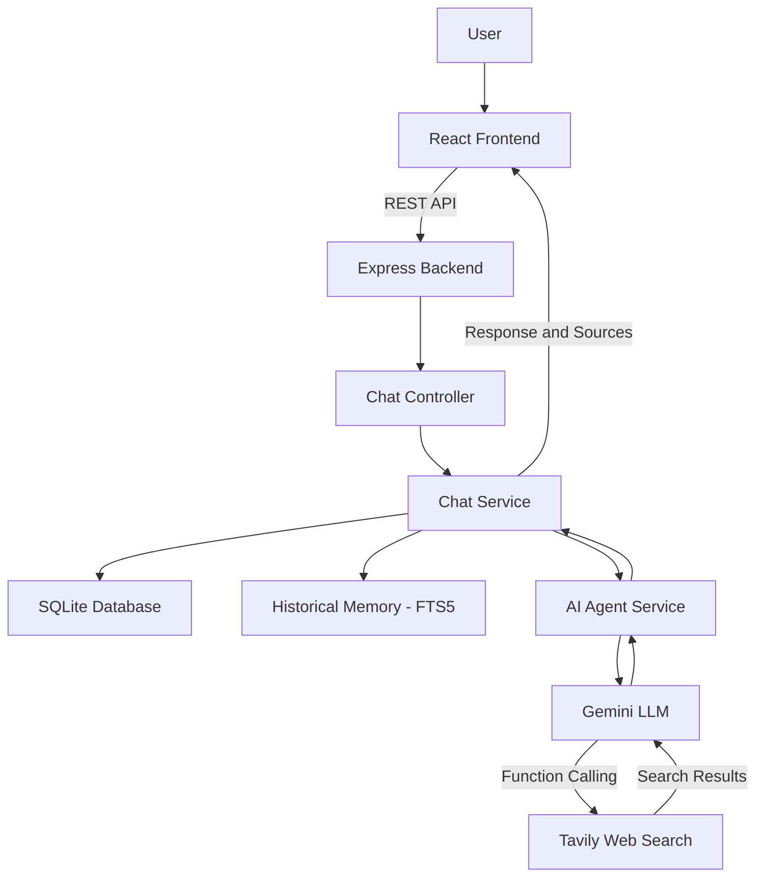

# Minimi — Design Document

## 1. How it works

Minimi is an AI chat application that combines current web search with historical conversation memory.

The application has a React frontend and an Express.js backend. The frontend sends messages to the backend through REST API endpoints. The backend retrieves recent conversation history and searches previous conversations using SQLite FTS5.

The request flow is:

1. The user sends a message from the React interface.
2. Express validates the request and stores the user's message in SQLite.
3. The memory layer retrieves recent messages and relevant messages from previous conversations using FTS5 keyword matching and BM25 relevance ranking.
4. The agent sends the conversation context to Gemini.
5. When current information is needed, Gemini can invoke the `search_web` tool through function calling. The tool uses Tavily to retrieve web results.
6. The agent returns the generated response and available source URLs.
7. Express stores the assistant response and sends it to the frontend.

Conversation history is persisted in SQLite, allowing users to reopen previous conversations.

## 2. Why I chose this architecture

I chose a modular Node.js architecture with Express, SQLite, Gemini function calling, and Tavily.

- **Node.js and Express:** Keep the backend lightweight and make API routes, services, tools, and memory responsibilities easy to separate.
- **SQLite:** Provides persistent storage without requiring a separate database server. It is sufficient for this application's scope.
- **SQLite FTS5:** Enables keyword-based historical conversation retrieval without introducing a separate search service or vector database.
- **Gemini function calling:** Allows the model to decide when it needs current web information instead of performing a search for every message.
- **Tavily:** Provides a focused web-search integration and source URLs.
- **React:** Provides a simple chat interface for conversations, message history, and conversation management.

I kept the agent, memory, search tool, and API layers separate so each responsibility can be modified independently.

## 3. Alternatives considered and rejected

- **Vector database and embeddings:** Considered for semantic memory retrieval, but rejected initially because FTS5 provides a simpler solution with fewer dependencies and no embedding-generation workflow.
- **MongoDB or PostgreSQL:** Considered, but SQLite was sufficient for a local, single-instance application and reduced infrastructure requirements.
- **Searching the web for every message:** Rejected because many questions can be answered from conversation context or the model's existing knowledge. Function calling lets the model request search when appropriate.
- **A single large backend file:** Rejected in favour of separate modules for routing, controllers, services, memory, agent logic, and tools.

These decisions prioritize simplicity and maintainability for the current scope. They are not claims that these choices are optimal for every production workload.

## 4. What I would build with another week

- Add authentication and user-specific conversation access instead of the current demo-user setup.
- Improve historical retrieval with embeddings and hybrid keyword-plus-semantic search, then evaluate relevance against representative questions.
- Add automated tests for API endpoints, memory retrieval, tool calling, and error handling.
- Improve reliability with request timeouts, structured logging, and stronger handling of provider failures and rate limits.
- Persist web-source metadata so source links remain available when conversations are reopened.
- Add deployment configuration and monitoring for a production environment.

The current implementation focuses on demonstrating the complete chat workflow, historical memory retrieval, and tool-based web search while keeping the architecture understandable and extensible.

## System Architecture

