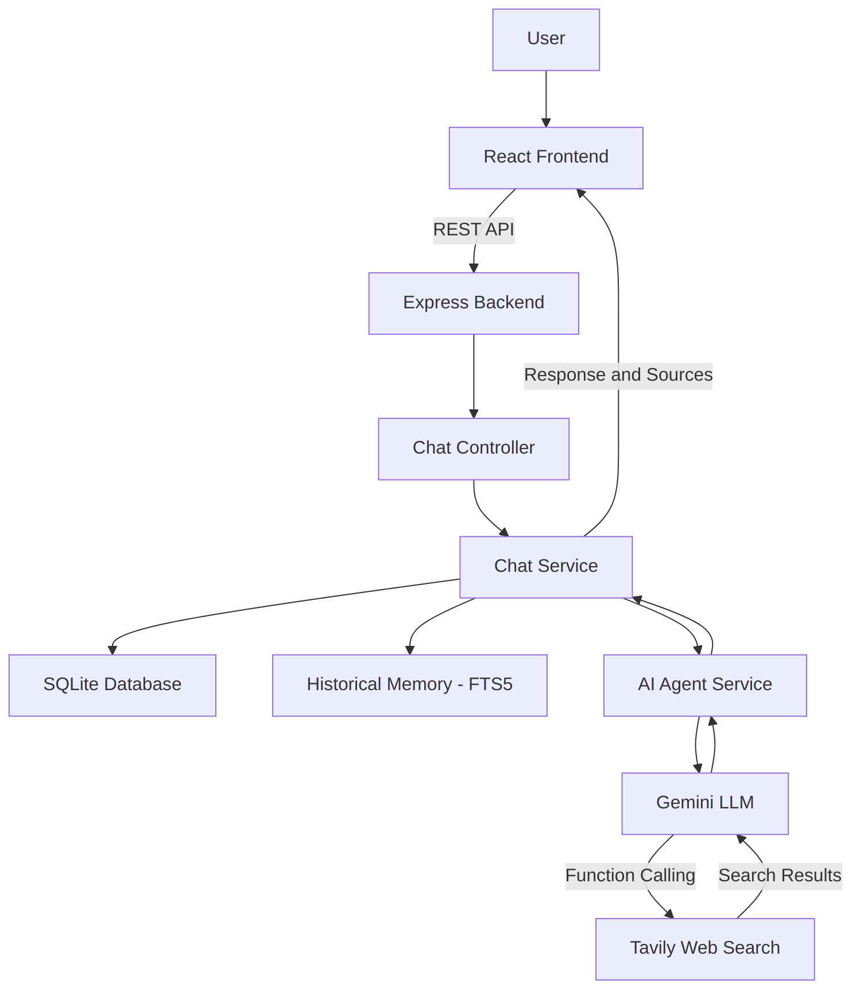

# Minimi – AI Chat Agent

Minimi is an AI-powered chat application that supports natural conversations, historical conversation memory, and real-time web search.

Users can ask questions, retrieve information from previous conversations, and search the web for current information through an AI-powered tool-calling workflow.

## Features

- **AI-powered conversations:** Generate responses using Google Gemini.
- **Historical conversation memory:** Retrieve relevant information from previous conversations using SQLite FTS5.
- **Web search:** Search the web using Tavily when current information is required.
- **Tool calling:** Gemini decides when to invoke the web search tool.
- **Conversation management:** Create, rename, delete, and reopen conversations.
- **Persistent storage:** Store conversations and messages in SQLite.
- **Source links:** Display web sources used in search-based responses.

## Tech Stack

| Layer | Technology |
|---|---|
| Frontend | React, Vite |
| Backend | Node.js, Express.js |
| AI Model | Google Gemini |
| Web Search | Tavily |
| Database | SQLite |
| Historical Search | SQLite FTS5 |
| Development | npm, concurrently |

## Architecture



## Project Structure

```text
minimi-chat-agent/
├── client/                 # React frontend
├── server/
│   └── src/
│       ├── agent/          # AI agent and prompts
│       ├── config/         # Database and Gemini setup
│       ├── controllers/    # API controllers
│       ├── memory/         # Conversation storage and retrieval
│       ├── routes/         # Express routes
│       ├── services/       # Chat processing
│       ├── tools/          # Tavily web search
│       └── utils/          # Shared utilities
├── .env.example
├── .gitignore
├── DESIGN.md
├── package.json
└── package-lock.json
```

## Prerequisites

- Node.js 22 or later
- npm
- Google Gemini API key
- Tavily API key

## Installation and Setup

### 1. Clone the repository

```bash
git clone https://github.com/yeshvaanth/minimi-chat-agent.git
cd minimi-chat-agent
```

### 2. Install dependencies

```bash
npm install
```

### 3. Configure environment variables

Create a `.env` file in the project root using `.env.example` as a reference.

```env
PORT=5000
CLIENT_URL=http://localhost:5173

GEMINI_API_KEY=your_gemini_api_key
GEMINI_MODEL=gemini-2.5-flash

TAVILY_API_KEY=your_tavily_api_key
```

Obtain your API keys:

- Google Gemini: https://aistudio.google.com/apikey
- Tavily: https://tavily.com/

### 4. Start the application

```bash
npm run dev
```

The frontend and backend start together.

| Service | URL |
|---|---|
| Frontend | http://localhost:5173 |
| Backend | http://localhost:5000 |
| Health Check | http://localhost:5000/health |

## API Endpoints

| Method | Endpoint | Description |
|---|---|---|
| POST | `/api/chat` | Send a chat message |
| GET | `/api/chat/conversations/:userId` | Retrieve conversations |
| GET | `/api/chat/conversations/:userId/:conversationId` | Retrieve conversation messages |
| PATCH | `/api/chat/conversations/:userId/:conversationId` | Rename a conversation |
| DELETE | `/api/chat/conversations/:userId/:conversationId` | Delete a conversation |

## Design Decisions

For architectural details, including how the application works, technology choices, alternatives considered, and future improvements, see [DESIGN.md](./DESIGN.md).

## Current Limitations

- Authentication is not implemented; the current application uses a demo user.
- Historical retrieval currently uses keyword-based FTS5 search rather than semantic vector search.
- The application is designed as a development prototype, not a production deployment.


